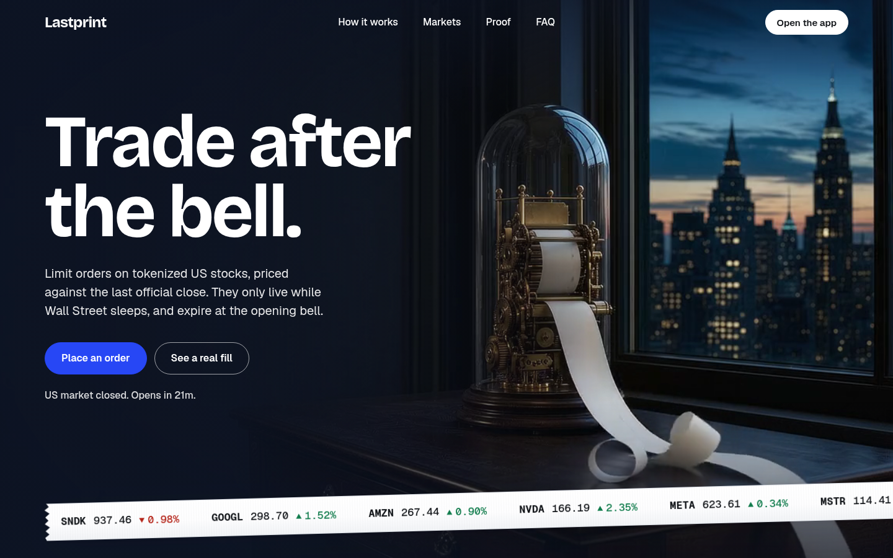

# Lastprint

**NYSE closes. Base doesn't.** Lastprint lets you set the price you want relative to the last close, and it only fires while Wall Street is asleep.

Lastprint gives you non-custodial limit orders for tokenized US stocks (Coinbase B20 tokens such as NVDAc) on Base. Each order is pegged to the **last official close**. It is live only while the US market is shut: overnight, weekends and US holidays. It expires automatically at the next opening bell. A keeper fills orders atomically on Aerodrome when the price is reached. [ActionFeed](https://basescan.org/address/0xC455472cd39029F8309F0D762Ee587D65A596Fe2) acts as the safety brake for corporate actions.

Lastprint is an independent project. It is not affiliated with Coinbase, Base, Aerodrome or Chainlink. It does not pick stocks or give advice, holds no funds, and has no token, points or fees.



## Why off-hours

Over the last 14 days, the main NVDAc/USDC Aerodrome pool did about the same average hourly volume while the US market was closed (~$318k/h) as during the session (~$323k/h). The 96 weekend hours did about $24.6M. People already trade these tokens off-hours. What they don't have is a limit order anchored to the close.

## How an order works

1. **Pick a market and a limit.** The ticket shows the last official close (with its source and date), the Base pool price and the gap between them. You enter your limit as "% vs last close", for example −1.5%. The ticket shows the absolute price next to it.
2. **Approve.** You approve the Lastprint contract for exactly the order amount. There is no unlimited approval.
3. **Sign.** You sign an EIP-712 order with `eth_signTypedData_v4`. The limit becomes an absolute `minAmountOut`, rounded in your favour, so the contract needs no price oracle. The order is valid from the last close until the next opening bell. It is also bound to the B20 UI multiplier you saw.
4. **Keeper watches.** Every ~5 s while the market is shut, the keeper quotes your exact amount on the pool. It fills when `quote ≥ minAmountOut × (1 + 15 bps)`. Before sending, it simulates the full `fill` with `eth_call`.
5. **Atomic fill.** `fill` checks the time window, your nonce, your signature, the ActionFeed guard and the multiplier. It pulls exactly `amountIn`, swaps through an allowlisted router, and checks that you received at least `minAmountOut`. It refunds any unused input. Then it resets the router approval to zero.
6. **Expiry.** At the opening bell the order can no longer fill. You can also cancel at any time (see below).

Full fills only.

## Trust model

| The keeper can | The keeper cannot |
|---|---|
| Choose *when* to fill within your window | Fill outside your window or below your `minAmountOut` |
| Choose the route through an allowlisted router | Send your output anywhere but to you; take more than `amountIn` |
| Decide not to fill (liveness) | Fill twice, fill after a cancel, fill across a multiplier change |

Filling is permissionless: anyone can call `fill`, and the guarantees are the same. The contract has no owner, no admin, no fees, no upgrade path and no stored funds. The router allowlist is fixed at deployment. Read [docs/threat-model.md](docs/threat-model.md) for every threat and the test that covers it.

**Cancelling.** "Cancel" in the app signs a free offchain message, which stops this keeper. "Cancel onchain" calls `cancel(nonce)`, which invalidates the order for everyone. `cancelUpTo(minNonce)` kills every older order in one transaction; nonces are time-ordered.

## ActionFeed guard

B20 tokens carry an ERC-8056-style UI multiplier: `shares = raw balance × multiplier`. Splits and dividend adjustments change it, sometimes on a schedule (`newUIMultiplier` with `effectiveAt`). Each fill:

- calls `ActionFeed.assertStable(stockToken, guardWindow)`, which reverts if a change goes live within `guardWindow` (1 day by default) or if transfers are paused;
- requires `ActionFeed.status(stockToken).uiMultiplier == order.stockMultiplier`.

An order signed against one multiplier therefore never fills against another. The multiplier is read from ActionFeed rather than from the token, so the guard and the multiplier come from one view of state. The reasoning is in the contract header.

## Market calendar

The regular session is 09:30–16:00 America/New_York, Monday to Friday. NYSE holidays and the 13:00 early closes for 2026 and 2027 are hard-coded from [NYSE Holidays & Trading Hours](https://www.nyse.com/markets/hours-calendars). Thanksgiving 2026 is Thursday 26 November (closed), with an early close on Friday 27 November. Outside 2026–2027 the clock fails closed and ordering is disabled. The calendar lives in `keeper/src/shared/market-clock.ts` and is tested across DST boundaries, Thanksgiving week, Christmas, New Year and weekends.

## Addresses (Base mainnet, 8453)

| What | Address | Source / check |
|---|---|---|
| USDC | `0x833589fCD6eDb6E08f4c7C32D4f71b54bdA02913` | |
| NVDAc (B20) | `0xb20000000000000000000078ee7ce2fE4908108C` | 8 decimals |
| NVDAc/USDC pool | `0xF668e21993f0ACd7ab00BB1cFbAeD0df28A3C8EC` | `factory()` = Slipstream V3 factory, tickSpacing 10 |
| Slipstream V3 CL factory | `0x9CB220581b91b0C83223012FE69688b92aD07a76` | `deployment-addresses/cl-base.json` in [Dromos-Labs/metadex-slipstream-public](https://github.com/Dromos-Labs/metadex-slipstream-public) |
| Slipstream V3 SwapRouter | `0x9Ee35Bf1bd69a03c6F0393582030fCe8Bb93D418` | same file; `cast call … factory()` returns the factory above; source verified on Sourcify |
| Slipstream V3 MetaQuoter | `0x1dDfeC5058180C207F55BB77D95AcDd0d8227868` | same file; Sourcify-verified; `quoteExactInputSingleV3(pool, tokenIn, amountIn, 0)` |
| ActionFeed | `0xC455472cd39029F8309F0D762Ee587D65A596Fe2` | interface in `contracts/src/interfaces/IActionFeed.sol` |

Note: the older Slipstream deployments listed in [aerodrome-finance/slipstream](https://github.com/aerodrome-finance/slipstream) belong to different factories. Their routers (`0xBE6D…18a5`, `0xcbBb…Ce0D`, `0x698C…A92F`) cannot reach the B20 pools; this was checked onchain with `factory()`. There is no QuoterV2 for the V3 factory; use the MetaQuoter.

## Data sources and credits

- **Last close:** the Yahoo Finance chart API is the primary source and the Nasdaq.com historical API is the fallback. Both are free, keyless and unofficial, without an SLA. The close is cached in SQLite with its source and fetch time, and is marked provisional within 30 minutes of the bell. Stooq was evaluated and rejected, because it now serves a JavaScript challenge to scripts.
- **Base prices:** pool `slot0` for the mid, and the Slipstream MetaQuoter for executable quotes at a $1,000 reference size.
- **Markets and pool depth:** the [DexScreener API](https://docs.dexscreener.com), filtered to pools with ≥ $100k liquidity whose factory is the Slipstream V3 factory and whose token reports a non-zero ActionFeed multiplier. Coinbase-wrapped crypto that shares the B20 address space (cbZEC, cbHYPE) is excluded.
- **Corporate actions:** ActionFeed.
- **Fonts:** Bricolage Grotesque, Geist and Geist Mono (SIL Open Font License 1.1, licenses in `keeper/public/fonts/`).
- **Photography:** the images in `keeper/public/img/` were generated for this project.
- **Libraries:** OpenZeppelin Contracts (MIT), forge-std (MIT/Apache-2.0), viem (MIT), Hono (MIT), esbuild (MIT).

Chainlink publishes B20 Total Return Value feeds on Base, but Lastprint does not depend on them.

## Layout

```
contracts/   Foundry: LastprintOrders.sol, interfaces, mocks, tests, Deploy.s.sol
keeper/      Node 26 + TypeScript: API, keeper loop, indexer, Telegram bot, web app (public/), scripts/
docs/        threat model, screenshots
```

## Run locally

Requires Node 26, pnpm and Foundry.

```sh
pnpm install
forge install foundry-rs/forge-std --root contracts   # solidity deps are not vendored
forge install OpenZeppelin/openzeppelin-contracts --root contracts
forge test --root contracts                 # contract tests
pnpm --dir keeper test                      # keeper tests (node --test)
pnpm --dir keeper typecheck                 # tsc
pnpm --dir keeper build:web                 # bundles viem + app into keeper/public/js
cp keeper/.env.example keeper/.env          # edit as needed
pnpm --dir keeper start                     # http://127.0.0.1:18797
```

Node runs the TypeScript directly (type stripping), with no build step for the server. If `LASTPRINT_ADDRESS` is unset, the app runs read-only: markets and gaps are live, and ordering is disabled with a notice. If `KEEPER_PRIVATE_KEY` is unset, the keeper runs watch-only: it decides and simulates, but never sends.

Other scripts:

```sh
pnpm --dir keeper markets:refresh    # rebuild keeper/markets.json from DexScreener + onchain checks
pnpm --dir keeper gap-report         # plain-text gap report + 1200x675 PNG of /report (needs the server running)
pnpm --dir keeper screens            # Playwright screenshots at 1440 and 390 px into docs/screens/v3-*.png (needs the server running)
```

### API

| Method | Path | Notes |
|---|---|---|
| GET | `/v1/markets` | ticker, token, pool, last close (source, time), multiplier, Base mid and quotes, gap %, depth, market open/closed, next open |
| POST | `/v1/orders` | `{ order, signature }`. Validates the EIP-712 signature (EOA and ERC-1271 via `eth_call`), the closed-market window, the multiplier, a limit within ±30% of the close, allowance and balance |
| GET | `/v1/orders?maker=0x…` | the maker's orders (signatures are never returned) |
| GET | `/v1/orders/:hash` | |
| POST | `/v1/orders/:hash/cancel` | `{ signature }` over `CancelOrder(bytes32 orderHash)`. Stops this keeper only; use onchain `cancel(nonce)` for a hard cancel |
| GET | `/v1/stats` | fills, volume, unique makers (from onchain `Filled` events), orders created |
| GET | `/v1/stream` | SSE `fill` events |

### Telegram (optional)

Set `TELEGRAM_BOT_TOKEN` (and `TELEGRAM_BOT_USERNAME` for the in-app link). `/start <address>` subscribes a chat to fills and expiries for that address; this is public onchain information only. `/gap` replies with the current gap table. There are no other commands.

## Deploy

```sh
cd contracts
ACTION_FEED=0xC455472cd39029F8309F0D762Ee587D65A596Fe2 \
ROUTERS=0x9Ee35Bf1bd69a03c6F0393582030fCe8Bb93D418 \
GUARD_WINDOW=86400 \
forge script script/Deploy.s.sol --rpc-url $RPC_URL            # simulate first
# then add --broadcast with your deployer key once reviewed
```

The router allowlist is permanent: list only swap routers (see the threat model). Then set `LASTPRINT_ADDRESS` and `LASTPRINT_DEPLOY_BLOCK` for the keeper, and fund a dedicated keeper key with a little ETH for gas.

### Live deployment (Base mainnet)

| What | Value |
|---|---|
| `LastprintOrders` | `0x7def4bbDdCe5670485f513615Cd5cAD97bB27DB3` |
| Deploy block | 56929424 |
| Source verification | Sourcify (`forge verify-contract … --verifier sourcify`) |
| Guard window | 1 day |
| Router allowlist | Slipstream V3 SwapRouter `0x9Ee35Bf1…D418` only |

The first real order filled on mainnet: 5 USDC for NVDAc at a limit of $170 per share while the US market was shut, filled for 0.0295619 NVDAc. Order hash `0x3a637e9692626eecae3fefb6903a7239a1d5dd90a60d2c0859d959bc43633d76`, fill transaction `0x4d6440b8055f7a4b373ce9a7eeb0ac12d0f7baa2dd278f409acb63728c37b872`. The contract is unaudited and holds no funds; treat it as experimental.

### Base App / Farcaster mini app

A stub manifest is served at `/.well-known/farcaster.json`. To finalize it:

1. Replace `REPLACE_WITH_DOMAIN` with the production domain, and add a 1200×630 `og.png` and a 1024×1024 PNG icon (the stub points at the SVG favicon).
2. Generate `accountAssociation` (`header`, `payload`, `signature`) for that domain with the Farcaster/Base developer tools, signed by the account that owns the app.
3. Remove `"noindex": true` when ready to be listed.

## Risks

- The contracts are experimental and **unaudited**.
- B20 tokens are a native, precompile-style standard. The unit tests use mocks, so real-token behaviour must be verified onchain with small amounts before use.
- Pool liquidity is thin compared with the listed exchange. Fills happen at your limit or better, but may not happen at all.
- A filler can capture any price improvement beyond your limit (by routing or sandwiching). Your limit is your guarantee.
- The close comes from free, unofficial data endpoints. It is shown for reference only; your signed `minAmountOut` is what counts.
- Issuer policy: B20 transfers are policy-gated, and an issuer can pause them. A paused token blocks fills.

## Disclaimer

Experimental software, provided as is under the MIT license. It is not available to U.S. persons or where prohibited. Nothing here is investment advice. Gap figures are descriptive data: "trades X% below last close" is a measurement, not a recommendation.
